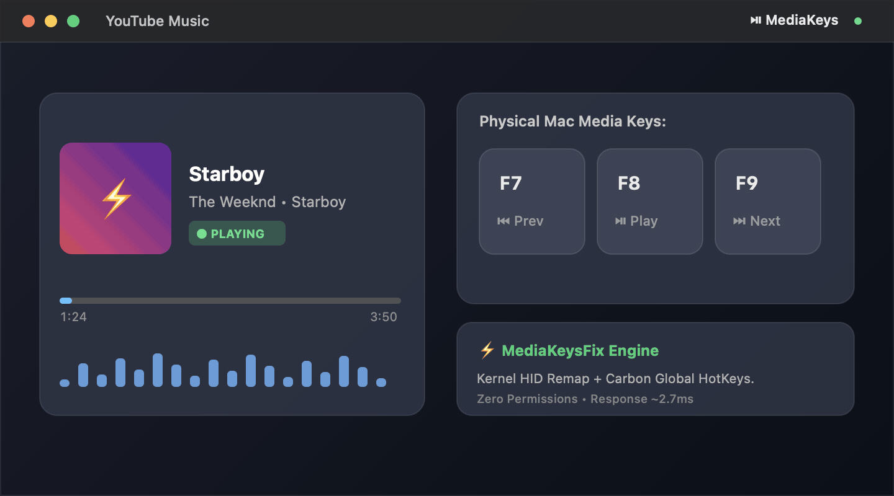

# MediaKeysFix

> Lightweight macOS menu bar utility that fixes unresponsive or bouncing physical media keys (F7, F8, F9).

[](https://github.com/wavehs/macos-mediakeys-fix)
[](https://github.com/wavehs/macos-mediakeys-fix)
[](LICENSE)

<p align="center">
  
</p>

---

## The Problem

On macOS, physical media keys often fail when controlling web players (YouTube Music, SoundCloud, Spotify web, background browser tabs):

* **Double-action bounce:** Pressing Play/Pause (F8) instantly pauses and unpauses due to WebKit event conflicts.
* **Background session drop:** When a browser window is minimized or backgrounded, macOS App Nap disconnects the NowPlaying session.
* **Heavy alternatives:** Most existing tools require invasive Accessibility permissions or run bloated background engines.

**MediaKeysFix** solves this by remapping the keys at the hardware HID layer and sending commands straight to macOS `MediaRemote` with intelligent debouncing. No Accessibility permissions required.

---

## Features

* **Instant Response (~2.7ms):** Direct private C-API dispatch to system media controls.
* **Zero Accessibility Permissions:** Operates without system permission prompts.
* **Menu Bar & Settings Window:** Clean tray icon with quick controls and a simple setup window.
* **Start at Login:** Integrated one-click startup toggle.
* **Sleep / Wake Auto-Recovery:** Restores key mappings automatically when waking up or reconnecting keyboards.
* **Fn-Key Passthrough:** Holding `Fn` (`Fn + F7 / F8 / F9`) still sends standard F-keys to your IDE or terminal.
* **Fallback Shortcuts:** `Ctrl + Option + Space` (Play/Pause), `Ctrl + Option + Left/Right` (Prev/Next).
* **Single-Instance Lock:** Guaranteed single process to prevent duplicate event triggers.

---

## Quick Start

### Option 1: Download Pre-built DMG (Recommended)

1. Download **[MediaKeysFix.dmg](https://github.com/wavehs/macos-mediakeys-fix/releases/latest)**.
2. Open the disk image and drag **MediaKeysFix.app** to your **Applications** folder.
3. Open **MediaKeysFix** from Applications:
   * When prompted, click **Enable (Recommended)** to allow starting on computer boot.
   * Look for the **⏯** icon in your menu bar tray.

> **Gatekeeper Note:** On first launch, right-click (or Control-click) `MediaKeysFix.app` in Applications and choose **Open** to clear macOS security prompts.

---

### Option 2: 1-Step Terminal Install

```bash
git clone https://github.com/wavehs/macos-mediakeys-fix.git
cd macos-mediakeys-fix
./install.sh
```

---

## Makefile Shortcuts

```bash
make app       # Compile and package MediaKeysFix.app
make dmg       # Build release-ready DMG installer and ZIP archive
make install   # Compile, install to /Applications, and start
make uninstall # Stop daemon, remove autostart agent, and restore defaults
make status    # Check key mapping and process status
make logs      # View live execution logs
```

---

## FAQ

**Does this require Accessibility permissions?**  
No. It remaps consumer keys via macOS `hidutil` and captures them using Carbon event handlers, which requires zero permissions.

**Does it work with Touch Bar Macs?**  
Touch Bar controls are virtual touch buttons, not physical keyboard keys. On Touch Bar models, use the fallback shortcuts (`Ctrl + Option + Space`).

**Can I still use F7–F9 as normal function keys in my code editor?**  
Yes. Hold the `Fn` key (`Fn + F7`, `Fn + F8`, `Fn + F9`). The fix only captures media events; native function keys pass directly to active programs.

---

## License

MIT License. Free and open source.

Maintained by [@wavehs](https://github.com/wavehs).
